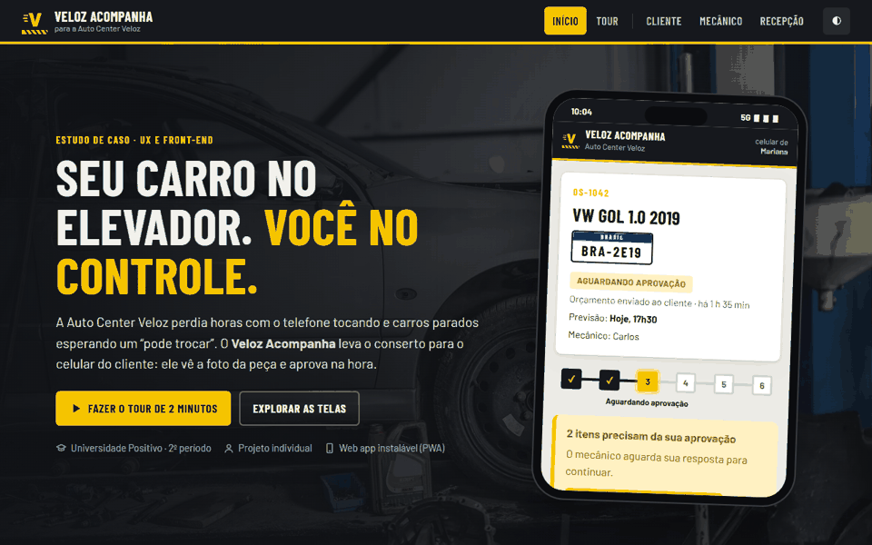
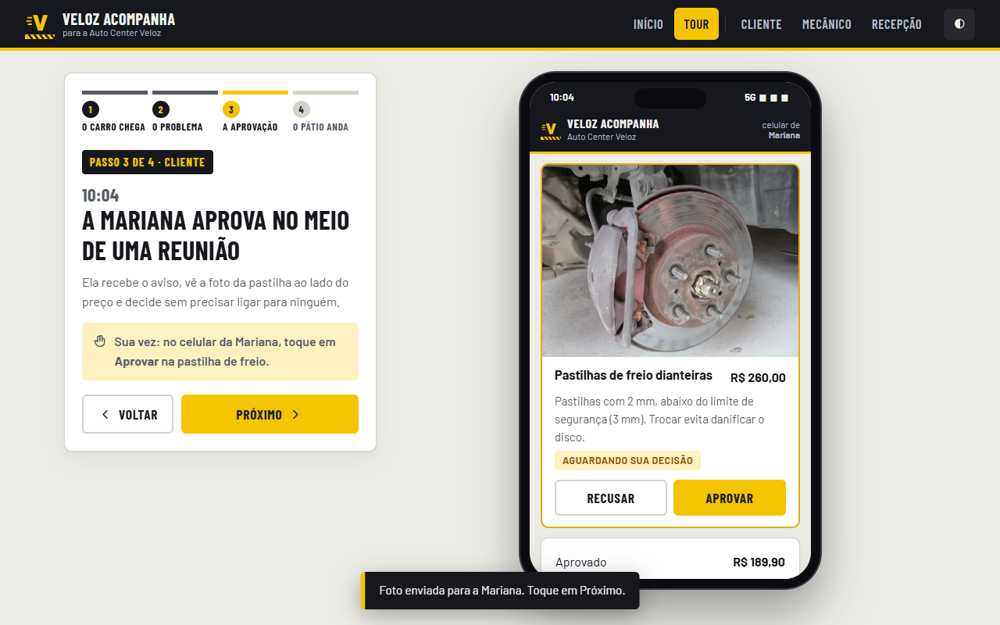
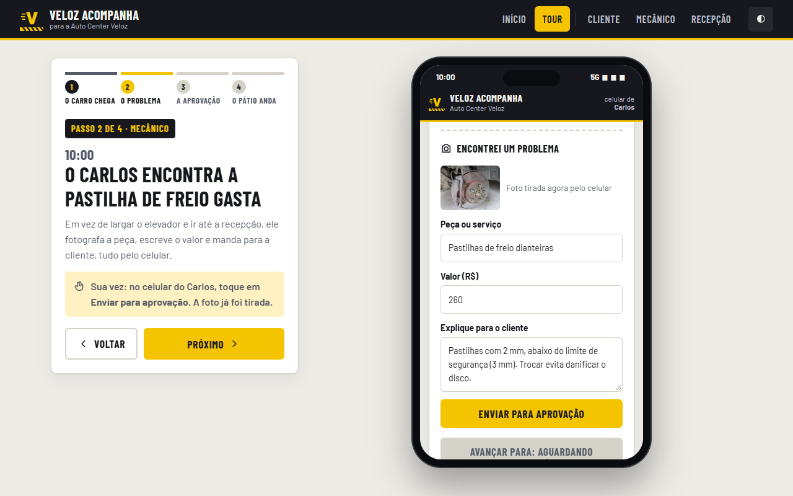
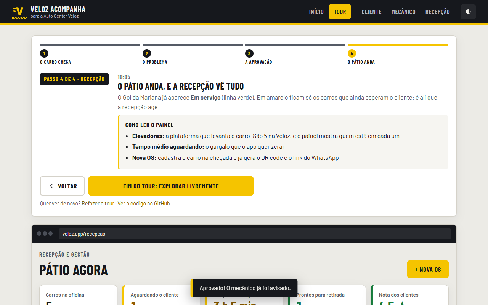

# Veloz Acompanha

**Web app para oficina mecânica em que o cliente acompanha o conserto e aprova o orçamento pelo celular, vendo a foto da peça.**

Estudo de caso de UX e front-end feito para a Auto Center Veloz, uma oficina fictícia criada para a disciplina de Design Profissional.

[](https://mmarcatoricardo.github.io/oficina-veloz/)




## O problema

A oficina tem ótima reputação técnica, 5 elevadores e 6 mecânicos. O gargalo estava na **conversa com o cliente**, não no conserto:

- o telefone da recepção não parava ("o carro já está pronto?", "manda foto da peça?");
- os mecânicos largavam o elevador para responder à recepção;
- os clientes demoravam horas para aprovar orçamento por mensagem, e o pátio lotava de carros parados.

| Antes: orçamento no papel | Depois: Veloz Acompanha |
|---|---|
| 10:00 o mecânico acha a pastilha gasta e vai até a recepção | 10:00 o mecânico fotografa a peça pelo celular |
| 10:15 a recepção liga, a cliente está em reunião | 10:04 a cliente vê a foto e o preço e toca em "Aprovar" |
| 13:40 chega um "pode trocar" por mensagem | 10:04 o serviço é liberado sozinho, sem passar pela recepção |
| **3 h 40 com o elevador parado** | **4 min** |

*Cenário ilustrativo, montado a partir do briefing do estudo de caso.*

## A solução

Um **web app** com três visões no mesmo produto. O enunciado deixava escolher entre app nativo, site institucional ou sistema. Como o problema é de comunicação **durante** o serviço, a escolha foi um web app: abre por um link no WhatsApp, sem instalar nada.

| Cliente (celular) | Mecânico (celular) | Recepção (computador) |
|---|---|---|
|  |  |  |

**Cliente**
- Acompanha as 6 etapas do conserto pelo link do WhatsApp ou pelo QR code do comprovante.
- Vê a **foto de cada peça com defeito** ao lado do preço e aprova ou recusa item por item.
- Recebe um **relatório digital** com fotos e histórico (salva em PDF) e avalia o atendimento no fim.

**Mecânico**
- Vê só as próprias ordens de serviço e avança a etapa com um toque.
- Em "Encontrei um problema", manda foto, valor e explicação direto para o cliente.
- O botão de avançar trava enquanto o cliente não responde: nada é feito sem autorização.

**Recepção e sócios**
- Painel do pátio: os 5 elevadores, os carros esperando resposta (em amarelo) e a nota dos clientes.
- Nova OS na chegada do carro, já com comprovante, QR code e mensagem pronta para o WhatsApp.

### Decisões de design

1. **Link, não loja de apps.** Ninguém instala app de oficina para usar duas vezes por ano.
2. **Foto ao lado do preço.** A confiança vem de ver a peça, com o motivo em linguagem simples.
3. **Uma decisão por vez.** Cada item tem só Aprovar ou Recusar; respondeu tudo, o serviço é liberado.
4. **Gargalo à vista.** Carros esperando há mais de 1 hora ficam em amarelo no painel.

### Como o site se apresenta

Quem chega pelo link não precisa adivinhar nada:
- a **página inicial** conta o problema e a solução;
- um **tour guiado de 4 passos** faz a pessoa viver o fluxo (WhatsApp → mecânico → cliente → pátio);
- cada tela tem um painel **"O que olhar"** que explica os termos da oficina (OS, elevador).

## Stack e arquitetura

HTML, CSS e JavaScript puros, **sem framework e sem build**. Funciona offline e roda no GitHub Pages.

| Camada | Decisão |
|---|---|
| Interface | HTML semântico; CSS com Grid, custom properties e **container queries** (a mesma tela se adapta dentro da moldura de celular) |
| Lógica | SPA em JavaScript com rotas por hash: `#/`, `#/tour/1-4`, `#/cliente/OS-1042`, `#/mecanico`, `#/recepcao`, `#/relatorio/:os`, `#/sobre` |
| Estado | `localStorage`; o evento `storage` sincroniza abas abertas (aprove numa aba e veja a outra atualizar) |
| PWA | `manifest.webmanifest` e service worker *network-first*: abre offline e pode ser instalado |
| Notificações | Notification API e toasts com `aria-live` |
| Relatório | Página com CSS de impressão: o "Salvar PDF" do navegador gera um documento limpo |
| Segurança | Texto digitado é escapado antes de ir para o HTML; nenhuma chave, token ou senha no código |

```
oficina-veloz/
├── index.html            # Página única com metatags (SEO e Open Graph)
├── 404.html              # Página de erro do GitHub Pages
├── manifest.webmanifest  # PWA
├── sw.js                 # Service worker (offline)
├── assets/               # Logo, ícones, imagem de compartilhamento e fotos (img/)
├── css/styles.css        # Design system: tokens, componentes, temas claro/escuro, impressão
├── js/data.js            # Etapas, mecânicos, dados de exemplo, cenário do tour e créditos
├── js/app.js             # Rotas, telas, tour guiado e ações
├── js/dev.js             # Página "Sobre": autor e repositórios via API pública do GitHub
└── docs/screenshots/     # Imagens deste README
```

**Lighthouse** (07/11/2026, servidor local): desktop 99 · 100 · 100 · 100 e celular 96 · 100 · 100 · 100 (performance · acessibilidade · boas práticas · SEO).

## Como rodar

Online: **https://mmarcatoricardo.github.io/oficina-veloz/**

Localmente, sem instalar dependências:

```bash
git clone https://github.com/MMarcatoRicardo/oficina-veloz.git
cd oficina-veloz
python -m http.server 8080
# abra http://localhost:8080
```

Abrir o `index.html` direto também funciona. Só o modo offline (service worker) exige o servidor.
Para recomeçar a demonstração, use **Restaurar dados de exemplo** no rodapé.

## Contexto

- **Atividade:** Estudo de Caso 3, Oficina e Auto Center Veloz (prática individual)
- **Disciplina:** Design Profissional: Produção de Portfólio e Desenvolvimento Empresarial, Prof. Sedenilso Antonio Machado
- **Curso:** Engenharia de Software, Universidade Positivo, 2º período (outubro de 2026)
- **Autor:** Ricardo Medeiros Marcato ([GitHub](https://github.com/MMarcatoRicardo) · [LinkedIn](https://www.linkedin.com/in/ricardo-medeiros-marcato/))

A oficina, as pessoas, placas e telefones são fictícios.

### Créditos das fotos

Fotos do [Wikimedia Commons](https://commons.wikimedia.org/), usadas conforme cada licença:

| Uso | Autor | Licença |
|---|---|---|
| [Capa](https://commons.wikimedia.org/wiki/File:Car_repair_in_an_auto_shop_with_tools_and_equipment_present_on_the_floor_and_a_partially_disassembled_vehicle_on_a_lift.jpg), [mecânico](https://commons.wikimedia.org/wiki/File:Car_mechanic_worker_repairing_suspension_of_lifted_automobile_at_auto_repair_garage_shop.jpg) e [elevador](https://commons.wikimedia.org/wiki/File:Car_lift_in_an_auto_repair_shop_with_vehicles_and_tools_present.jpg) | Shixart1985 | CC BY 2.0 |
| [Pastilha de freio](https://commons.wikimedia.org/wiki/File:Alarm_bells!_(25681917701).jpg) | Riley from Christchurch, New Zealand | CC BY 2.0 |
| [Palheta do limpador](https://commons.wikimedia.org/wiki/File:Or_none_at_all._My_wiper_blades_have_not_moved_in_weeks_and_are_good_at_trapping_pine_needles._(2982646061).jpg) | cogdogblog | CC0 |
| [Teste de bateria](https://commons.wikimedia.org/wiki/File:Car_battery.jpg) | Azorbli | CC BY-SA 4.0 |
| [Amortecedor](https://commons.wikimedia.org/wiki/File:Federbein_Seicento.JPG) | Bukk | Domínio público |

As fotos foram redimensionadas e convertidas para WebP. A biblioteca [qrcodejs](https://github.com/davidshimjs/qrcodejs) (MIT) gera os QR codes, e as fontes Barlow e Barlow Condensed vêm do Google Fonts (OFL).

## Licença

Código sob a licença MIT. Veja [LICENSE](LICENSE). As fotos seguem as licenças da tabela acima.
